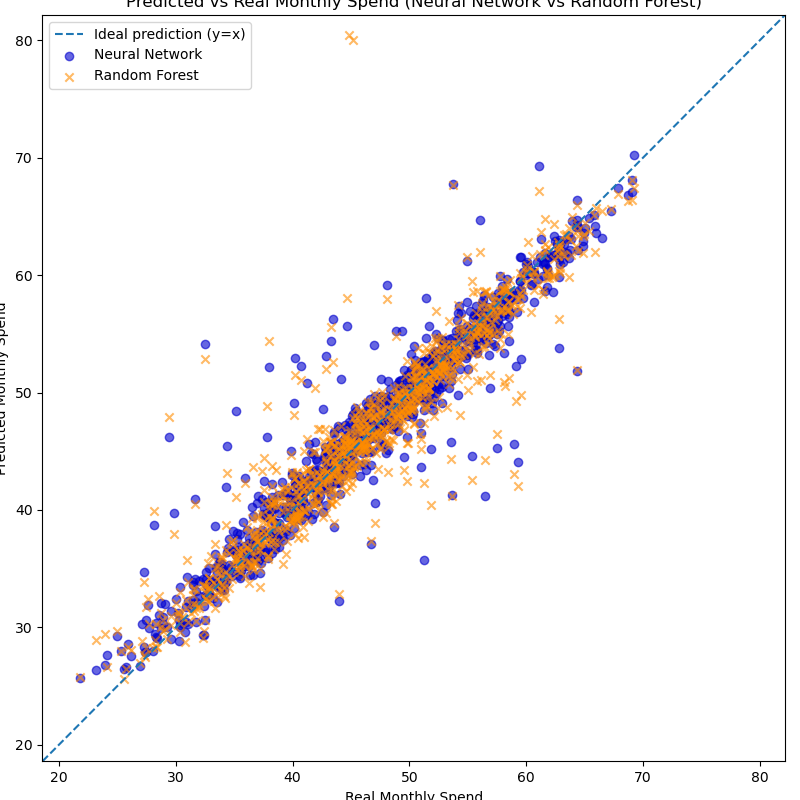
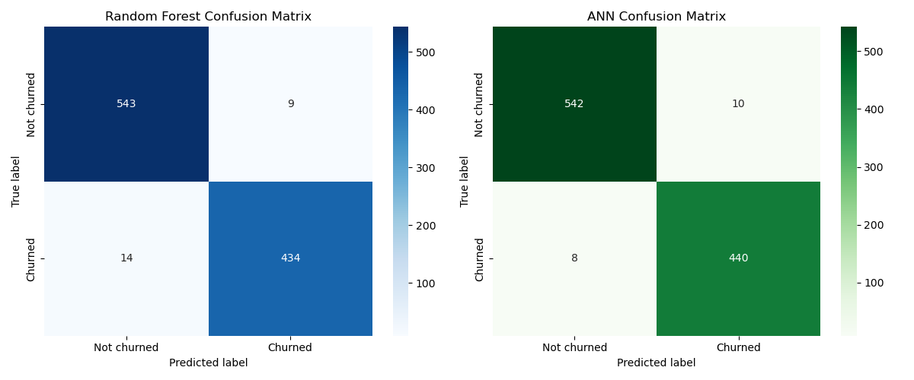
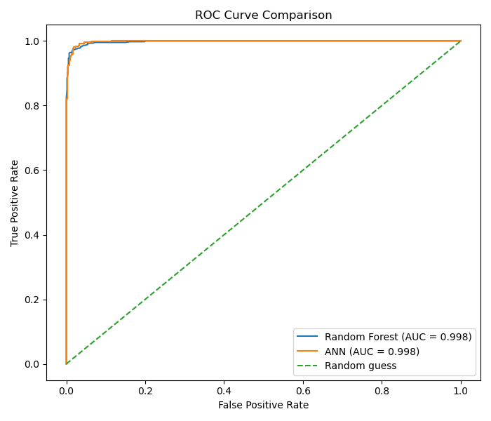
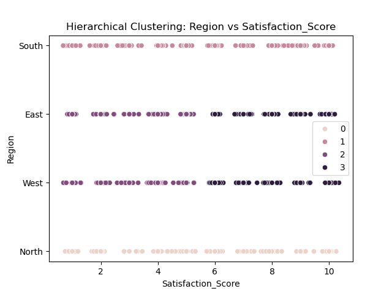

# Customer Behaviour in Streaming Services

Supervised and unsupervised learning on a streaming-service customer dataset. The goal is to
predict how much a customer spends and whether they will churn, and to segment customers into
groups with similar behaviour.

MSc coursework, Applied and Understanding AI module, University of Hull.

---

## The problem

Spend and churn are the two numbers a subscription business watches most. This project asks
three things of a customer dataset: can monthly spend be predicted from customer attributes,
can churn be predicted before it happens, and do customers fall into meaningful segments that a
retention team could act on.

---

## Data

A streaming-service customer dataset from Kaggle (`data/Streaming.csv`, included). Each row is a
customer with age, region, gender, payment method, subscription length, satisfaction score,
support tickets, last activity, monthly spend, and a churn flag. Age and satisfaction score had
missing values; a two-sample t-test showed the missingness was unrelated to spend (missing
completely at random), so the gaps were filled with Kernel Density Estimation, which preserves
each feature's shape. Two invalid negative spend values (0.04% of rows) were removed rather than
imputed, since spend is the target.

---

## Method

**Regression (monthly spend).** Single-feature linear and degree-2 polynomial models, a
multi-feature model, a Random Forest, and a tuned neural network. Numeric features standardised,
categoricals one-hot encoded. Scored with MAE, MSE, RMSE and R².

**Classification (churn).** Logistic Regression, Random Forest, and a neural network, on numeric
and categorical features, with a stratified split. Scored with accuracy, precision, recall, F1
and AUC-ROC.

**Clustering.** k-Means with the elbow method across several feature groups, compared against
hierarchical clustering, evaluated with the Davies-Bouldin and silhouette scores.

---

## Results

**Predicting spend.** A single feature is not enough. Combining features lifts R² from 0.47
(best single-feature) to 0.85 and above, and the neural network is best.

| Regression model | MAE | RMSE | R² |
|---|---|---|---|
| Best single-feature (Satisfaction Score) | 5.41 | 6.84 | 0.467 |
| Multi-feature polynomial (deg 2) | 1.78 | 3.56 | 0.856 |
| Random Forest | 1.89 | 3.61 | 0.846 |
| Neural network (best) | **1.65** | **2.82** | **0.906** |



**Predicting churn.** The tree and network models are near perfect and comfortably beat logistic
regression, with the neural network catching slightly more churners.

| Churn model | Accuracy | F1 | AUC-ROC |
|---|---|---|---|
| Logistic Regression | 0.816 | 0.794 | 0.905 |
| Random Forest (200 trees) | 0.977 | 0.974 | 0.998 |
| Neural network (best) | **0.982** | **0.980** | 0.998 |




**Segmenting customers.** k-Means and hierarchical clustering were compared across feature groups
using the elbow method and cluster-quality scores to find the segmentation that separates
customers most cleanly.



The recurring lesson across all three tasks is that combining features, rather than relying on
any single one, is what drives both prediction and clean segmentation.

---

## Repository structure

```
msc-customer-behaviour-analysis/
  notebooks/
    customer_behaviour_analysis.ipynb   regression, churn classification, and clustering
  src/
    preprocessing.py   missingness t-test and KDE imputation
  reports/figures/   figures used above
  data/Streaming.csv the dataset (small, included)
  requirements.txt
```

The notebook holds the full analysis; `src/` holds the reusable cleaning helpers.

---

## Running it

```bash
python -m venv .venv && source .venv/bin/activate   # Windows: .venv\Scripts\activate
pip install -r requirements.txt
```

Then run `notebooks/customer_behaviour_analysis.ipynb`. The data is already in `data/`.

---

## Tools

Python, scikit-learn, TensorFlow/Keras, pandas, NumPy, SciPy, Matplotlib, seaborn.
